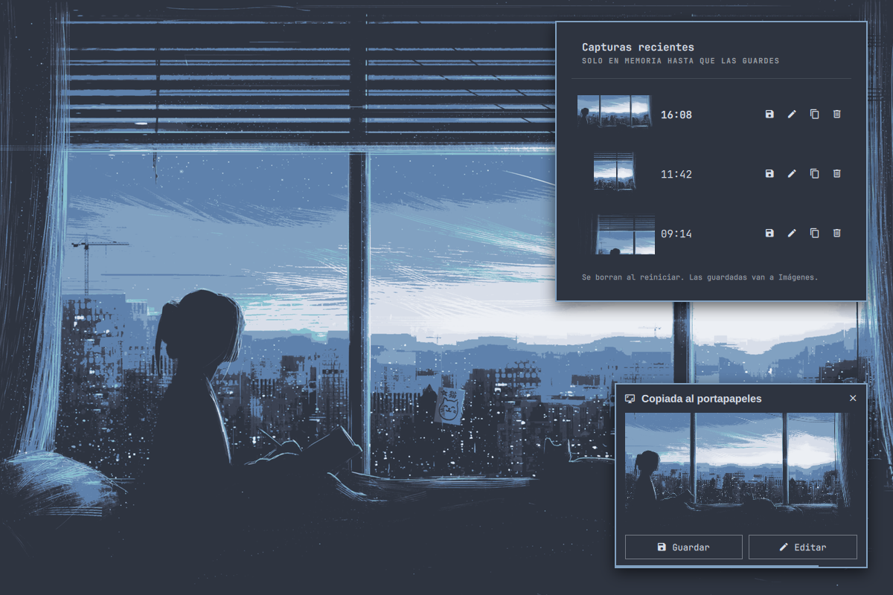
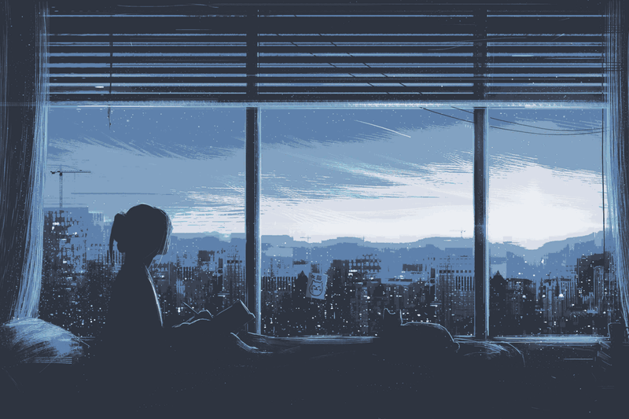

# Screenshot Clip for Omarchy

Print Screen copies to the clipboard instead of filling `~/Pictures`. A card
lets you save, edit or close each screenshot, and the bar keeps your recent ones
until reboot, so you only ever save the screenshots you want to keep.

*[Español más abajo](#español)*



## Why

Omarchy's Print Screen saves every capture as a PNG in `~/Pictures`, even the
ones you only meant to paste into a chat once. After a few weeks the folder holds
hundreds of screenshots nobody will open again.

Screenshot Clip turns that around: nothing is written to disk unless you ask.

## How it works



1. Press <kbd>Print</kbd> and select as usual: the screen freezes, <kbd>Space</kbd>
   snaps to a window, <kbd>F</kbd> takes the whole screen. It is Omarchy's own
   region picker, so selection behaves exactly like the stock screenshot.
2. The screenshot goes to the **clipboard**, ready for <kbd>Ctrl</kbd>+<kbd>V</kbd>.
3. A card shows up in the corner with the thumbnail:
   - **Save** copies it to `~/Pictures/screenshot-YYYY-MM-DD_HH-MM-SS.png`.
   - **Edit** (or clicking the picture) opens it in Tensaku. There
     <kbd>Ctrl</kbd>+<kbd>S</kbd> saves and <kbd>Enter</kbd> copies the edited
     image without saving a file.
   - **✕** or a right-click closes it. Otherwise it leaves by itself after a few
     seconds, and waits while the pointer is over it.
4. Missed it? The bar button lists your **recent screenshots** with Save, Edit,
   Copy and Delete for each one.

Screenshots live in `$XDG_RUNTIME_DIR/screenshot-clip/`, which is in memory and
cleared on reboot. Only the newest 10 are kept (configurable).

Optical character recognition (<kbd>Super</kbd>+<kbd>Ctrl</kbd>+<kbd>Print</kbd>)
and screen recording (<kbd>Alt</kbd>+<kbd>Print</kbd>) are not changed.

## Install

```bash
omarchy plugin add https://github.com/Slylem0/omarchy-screenshot-clip
omarchy-restart-shell
```

That's all. While the plugin is enabled it binds <kbd>Print</kbd> by itself, so
there is nothing to edit in `~/.config/hypr`. Disable or remove the plugin and
Omarchy's own screenshot is back on <kbd>Print</kbd>.

Place the bar button if you want the recent screenshots panel (right-click it to
take a screenshot):

```bash
omarchy bar put slylem0.screenshot-clip
```

## Settings

From the bar widget's settings, or inline in its `shell.json` entry:

| Setting | Default | |
|---|---|---|
| `language` | `auto` | `auto` follows the system locale; `en` or `es` |
| `seconds` | `6` | How long the card stays (2–30); it waits while hovered |
| `keep` | `10` | Recent screenshots kept in memory (1–50) |
| `takeOverPrint` | `true` | Turn off to leave Omarchy's screenshot on <kbd>Print</kbd> |

## Keyboard

Recent screenshots panel: arrows move, <kbd>Enter</kbd> saves, <kbd>E</kbd>
edits, <kbd>C</kbd> copies, <kbd>Delete</kbd> deletes, <kbd>Esc</kbd> closes.

The card can be driven from your own bindings too:

```lua
o.bind("SUPER + PRINT", "Save last screenshot", "omarchy-shell slylem0.screenshot-clip save")
```

`save`, `edit` and `dismiss` act on the card on screen.

## Command line

`bin/screenshot-clip` works on its own as well:

```
screenshot-clip [smart|region|windows|fullscreen]   capture (default smart)
screenshot-clip save <file>                         copy into ~/Pictures
screenshot-clip edit <file>                         open in Tensaku
screenshot-clip copy <file>                         back onto the clipboard
screenshot-clip delete <file>                       drop the temporary copy
screenshot-clip list                                temporary copies, newest first
```

`save`, `edit`, `copy` and `delete` only touch files inside the temporary folder.
If the shell service is not running, a capture falls back to a notification whose
click opens the editor.

## Requirements

Omarchy 4 with its stock screenshot tools: `grim`, `wl-copy`, `tensaku` and
`omarchy-capture-region`.

## Tests

```bash
test/run
```

Runs the script against stubbed `grim`, `wl-copy`, Tensaku, notifier and shell,
so it never touches your screen, clipboard or pictures folder; then the
`Model.js` unit tests under node, and validates the manifest.

---

## Español

<kbd>Impr Pant</kbd> copia la captura al portapapeles en vez de llenar
`~/Pictures`. Una tarjeta te deja guardarla, editarla o cerrarla, y la barra
conserva las recientes hasta que reinicies: solo guardas las que quieres.

1. Presiona <kbd>Impr Pant</kbd> y selecciona como siempre (<kbd>Espacio</kbd>
   para una ventana, <kbd>F</kbd> para la pantalla completa).
2. La captura queda en el **portapapeles**. No se guarda nada en disco.
3. En la tarjeta de la esquina:
   - **Guardar** la copia a `~/Pictures`.
   - **Editar** (o clic en la imagen) la abre en Tensaku: <kbd>Ctrl</kbd>+<kbd>S</kbd>
     guarda y <kbd>Enter</kbd> copia la versión editada sin guardar archivo.
   - **✕** o clic derecho la cierra. Si no, se va sola a los pocos segundos, y
     espera mientras tengas el puntero encima.
4. ¿Se te pasó? El botón de la barra muestra las **capturas recientes** con
   Guardar, Editar, Copiar y Borrar.

Las capturas viven en la memoria (`$XDG_RUNTIME_DIR`) y se borran al reiniciar.
El plugin asigna <kbd>Impr Pant</kbd> por sí solo mientras está activo; al
desactivarlo vuelve la captura normal de Omarchy. Instálalo con los comandos de
*Install* y elige el idioma en los ajustes del widget (`language: es`).

## License

MIT
